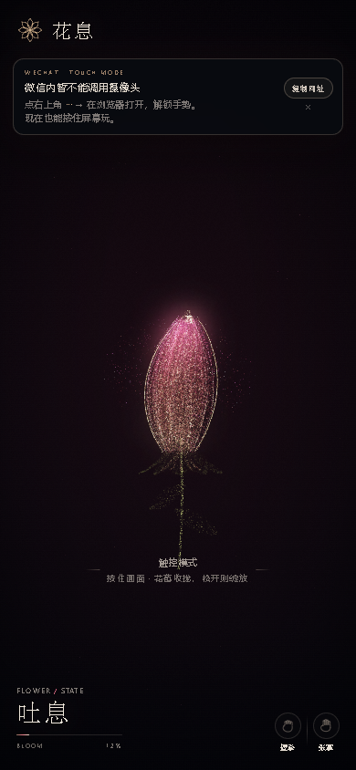
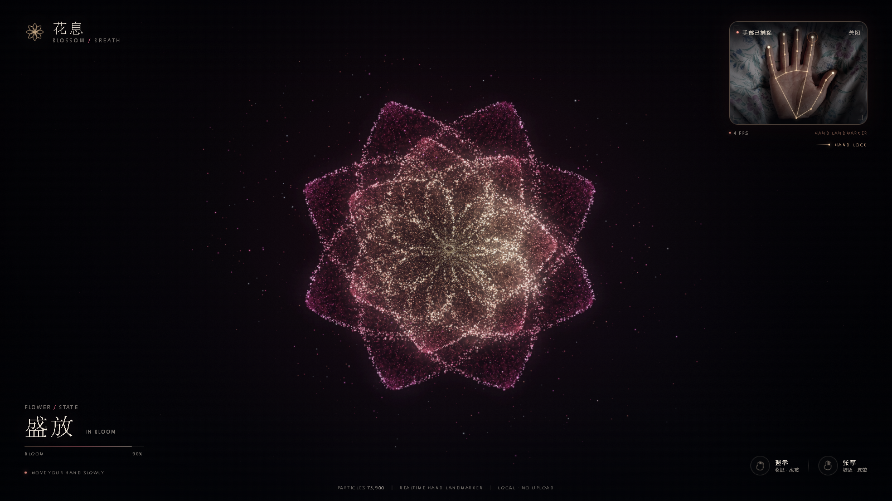

# 花息 · Blossom Breath

一朵由 73,900 个粒子组成的花。摄像头读取手部关键点：**张掌时粒子向外绽放，握拳时收拢成花苞，移动指尖时花朵轻轻跟随**。

## 在线访问

**[打开花息 →](https://3220345254-svg.github.io/blossom-breath/)**


手机、平板、电脑都可以直接打开，无需安装任何东西；首次打开允许摄像头即可。在线版使用 HTTPS，手机浏览器也能正常请求摄像头。

### 微信里打开

微信内置浏览器不提供网页实时摄像头，页面会自动切到**触控模式**，不会卡在“镜头连接中”：

- 现在就能玩：**按住画面收拢成花苞，松开则绽放**。
- 想用手势：点右上角 **···** → **在浏览器打开**，在系统浏览器里允许摄像头即可。
- 页面内的“复制网址”按钮可把链接复制出来，粘贴到浏览器打开。



> 如果所在网络访问 GitHub Pages 不稳定，可以用下面的本地方式打开。



## 本地运行

需要 Chrome / Edge（支持 WebGL2 与摄像头），以及本机 Python 3。

**双击 `启动.bat`**，会自动打开：

```
http://127.0.0.1:8848/
```

也可以在该目录手动启动：

```bash
python -m http.server 8848 --bind 127.0.0.1
```

> 不能直接双击 `index.html`：页面使用 ES Module 与本地 MediaPipe wasm，必须通过 HTTP 访问。

首次打开会请求摄像头权限。允许后约 1 秒完成手部模型加载。

## 手势

| 动作 | 效果 |
| --- | --- |
| 手掌张开 | 花朵完全绽放，粒子向外扩散 |
| 握拳 | 花朵收拢为竖直花苞，茎叶显现 |
| 移动食指 | 花朵跟随指尖位置轻微平移、偏转 |
| 手离开画面 | 回到默认的含苞呼吸状态 |

右上角是摄像头预览与 21 点手部骨架；可点“关闭”停止摄像头。

### 没有摄像头 / 不想授权

页面仍可玩：

- **按住画面 = 握拳**，松手 = 张掌。
- **空格键**按下/松开同样模拟握拳/张掌。
- **C 键**随时开关摄像头。

展示模式可加参数 `?demo=1`（不自动开摄像头，只保留鼠标/键盘互动）。

## 说明

- **完全本地**：手部识别使用随包携带的 MediaPipe HandLandmarker，视频帧不上传，页面无外部网络请求。
- **视觉**：原生 WebGL2 粒子系统 + 两级 bloom；花瓣、花蕊、花粉、花苞、茎叶分别是独立粒子层。
- **相机**：手机竖屏会自动拉远镜头，避免花朵贴边；公网版使用 HTTPS，系统浏览器可直接授权摄像头。微信内置浏览器不提供实时摄像头，请用触控模式或点“在浏览器打开”。
- **性能**：73,900 个粒子，桌面独显/集显均可运行；若帧率偏低，可关闭其他占用 GPU 的页面。

## 文件

```
index.html          页面结构
css/style.css       视觉与响应式
js/particles.js     粒子几何（花、花苞、茎叶）
js/renderer.js      WebGL2 渲染与 bloom
js/hand.js          MediaPipe 手部检测、开合度、骨架
js/main.js          状态机、手势映射、鼠标/键盘回退
vendor/mediapipe/   本地模型与 wasm
screenshots/        交付截图
启动.bat            一键预览
```

## 自测记录

- Chrome headless + 假摄像头：张掌 `handOpen≈0.90`，目标开合度同步；鼠标回退按下/松开、空格键均实测。
- 无摄像头：权限拒绝后显示错误卡片，鼠标回退可用。
- 微信 UA（`MicroMessenger`）模拟：自动进入触控模式，摄像头模块隐藏，按住/松开实测 0.04 → 0.92，不再出现“镜头连接中”。
- 摄像头授权挂起模拟：9 秒后转为“摄像头启动超时”，不会无限等待。
- 尺寸：1600×900、1280×720、390×844 三种布局截图核对。
- 静态握拳照片在 IMAGE 模式判定开合度为 0；VIDEO 模式对“一开始就紧握的静态拳”可能检不到手，此时页面会回落到默认花苞，视觉结果一致。
